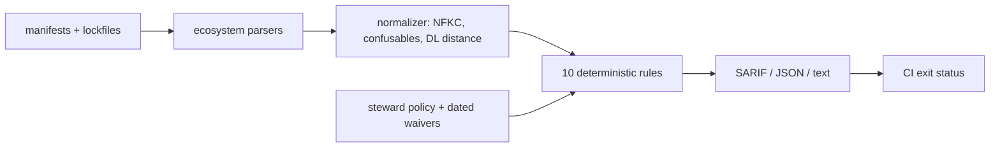

# Baysöz Labs <baysozlabs@proton.me>

# slopsquatgate — offline dependency-origin conformance oracle

[](https://github.com/yazilimbaysoz-svg/baysoz-slopsquatgate/actions/workflows/ci.yml)
[](https://www.python.org/downloads/)
[](LICENSE)
[](https://json.schemastore.org/sarif-2.1.0.json)
[](docs/ARCHITECTURE.md)

`slopsquatgate` catches **slopsquatting, typosquatting, private-package shadowing, mutable dependency
references, untrusted artifact hosts, missing integrity material, implicit install hooks, and lockfile
drift** across Python, npm, Cargo, and Go manifests. It is a deterministic, offline, stdlib-only Python
3.13 CLI and library for appsec red teams and CI stewards.

Authored by **Baysöz Labs <baysozlabs@proton.me>**.

## Why it exists

AI coding agents now write dependency manifests. Package names that do not exist are a documented
failure mode ("slopsquatting"), and public registries will happily resolve a name that an internal
package was expected to own. A red team needs to prove the gap before an attacker registers the name;
a steward needs a deterministic gate that fails CI without a network call.

Existing ecosystem tooling answers adjacent questions (SBOM advisories, SLSA provenance, GitHub Actions
lockfiles, secret masking). None of them decides **whether a declared dependency name is the one the
organization meant to resolve**. See [docs/MARKET_RESEARCH.md](docs/MARKET_RESEARCH.md).

## Install

```bash
uv tool install slopsquatgate
# or, from a checkout
uv venv
uv pip install -e .
uv run slopsquatgate --version
```

Requires Python 3.13 or newer. No services, no local models, no runtime dependencies, no telemetry.

## Real CLI output

```text
$ slopsquatgate scan examples/adversarial --include requirements.txt \
    --as-of 2026-11-27 --format text --fail-on never
slopsquatgate 1.0.0 — offline dependency-origin conformance oracle
Baysöz Labs <baysozlabs@proton.me>
root: examples/adversarial | as-of: 2026-11-27 | files: 1
findings: 5 (critical 0 high 3 medium 2 low 0 info 0)
[HIGH    ] SQ002 requirements.txt:2:1 reqeusts
           evidence: 'reqeusts' is near trusted names: requests (transposition, distance 1)
           fix: Verify the package owner and registry namespace, then pin the exact vetted version or add an allowlist entry.
[MEDIUM  ] SQ008 requirements.txt:2:1 pypi
           evidence: no lockfile discovered for ecosystem 'pypi'; exact pins cannot be verified
           fix: Regenerate and commit the lockfile so exact declared versions are verifiable in CI.
[MEDIUM  ] SQ004 requirements.txt:5:1 shared-tool
           evidence: shared-tool: missing-or-wildcard-version, path-escapes-project-root
           fix: Pin an exact version or an immutable commit SHA and reject wildcard or branch references.
[HIGH    ] SQ005 requirements.txt:6:1 --extra-index-url https://mirror.evil.invalid/simple
           evidence: artifact host 'mirror.evil.invalid' is not in the trusted-hosts policy
           fix: Remove the override or add the host to a reviewed trusted-hosts policy; never disable TLS verification.
[HIGH    ] SQ005 requirements.txt:7:1 --trusted-host mirror.evil.invalid
           evidence: TLS certificate verification disabled: --trusted-host mirror.evil.invalid
           fix: Remove the override or add the host to a reviewed trusted-hosts policy; never disable TLS verification.
report signed: Baysöz Labs <baysozlabs@proton.me>
```

The full nine-file adversarial corpus produces 25 findings across seven rule families with zero parse
errors; see [docs/TRIBUNAL.md](docs/TRIBUNAL.md).

## Architecture



Details: [docs/ARCHITECTURE.md](docs/ARCHITECTURE.md). Rule definitions live in
`src/slopsquatgate/rules.py`; parsers are isolated under `src/slopsquatgate/parsers/`.

## Commands

```bash
slopsquatgate scan . --format sarif --out slopsquatgate.sarif
slopsquatgate scan . --format json --fail-on critical
slopsquatgate init-policy --out policy.json
slopsquatgate scan . --policy policy.json --as-of 2026-11-27
slopsquatgate explain SQ002
slopsquatgate rules
```

Exit codes: `0` clean under threshold, `1` finding at or above threshold, `2` invalid input/policy.

## Library use

```python
from datetime import date
from slopsquatgate.policy import Policy
from slopsquatgate.scan import scan

result = scan("repo", policy=Policy(), as_of=date(2026, 11, 27))
for finding in result.findings:
    print(finding.rule_id, finding.location.path, finding.evidence)
```

## Rules

| ID | Default | Meaning |
| --- | --- | --- |
| SQ000 | medium | Manifest could not be parsed |
| SQ001 | high | Unicode control or confusable character in a dependency reference |
| SQ002 | high | Near-miss package name versus the curated baseline or allowlist |
| SQ003 | critical | Private namespace without an internal registry pin |
| SQ004 | medium | Mutable version, branch, wildcard, or escaping path reference |
| SQ005 | high | Untrusted artifact host or TLS verification override |
| SQ006 | medium | Locked artifact without integrity material |
| SQ007 | high | Install lifecycle script or build-time dependency |
| SQ008 | medium | Missing or drifted lockfile entry |
| SQ009 | high | Expired waiver still suppressing a live finding |

## Enterprise layout

- `docs/MARKET_RESEARCH.md` — live ecosystem evidence and gap analysis
- `docs/ARCHITECTURE.md` — design, data flow, determinism, threat model
- `PLAN.md` — delivery plan and quality-gate record
- `SECURITY.md` — vulnerability reporting and safe deployment
- `CHANGELOG.md` — release history
- `src/slopsquatgate/` — CLI, policy, rules, reporters, parsers
- `tests/` — adversarial parser, rule, policy, and CLI tests

## Attribution and license

Baysöz Labs <baysozlabs@proton.me> — MIT License, see [LICENSE](LICENSE).
No legal entity suffix is used or implied.
