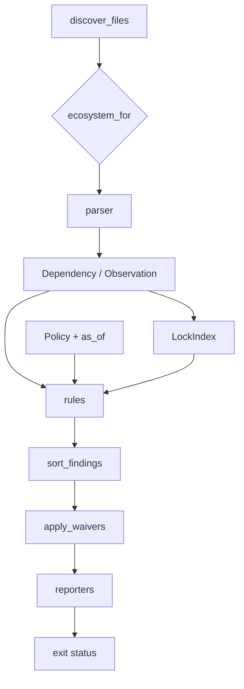

# Architecture — Baysöz Labs <baysozlabs@proton.me>

## 1. System boundary

`slopsquatgate` is a pure function over a filesystem tree plus a steward policy:

```text
(root, policy, as_of) -> ScanResult
```

It performs no network I/O, no subprocess execution, no dynamic code loading, no telemetry, and no
model inference. Input size is bounded at 2,000,000 bytes per manifest. Only known manifest filenames
are parsed; binary files and dependency directories are ignored.

## 2. Module map

| Module | Responsibility |
| --- | --- |
| `model.py` | Immutable `Location`, `Dependency`, `Observation`, `Manifest`, `Finding`, `ScanResult`, `LockIndex` |
| `normalize.py` | Unicode NFKC folding, confusable mapping, Damerau-Levenshtein, host extraction, mutable-ref classification |
| `corpus.py` | Versioned curated baseline of high-prevalence package names (`BASELINE_VERSION = 2026-11-27`) |
| `policy.py` | Strict JSON policy validation, trusted/denied hosts, private prefixes, dated waivers, severity overrides |
| `parsers/common.py` | Bounded UTF-8 reading, line/column mapping, JSON/TOML string-literal index |
| `parsers/python_parser.py` | requirements, pyproject, uv.lock |
| `parsers/npm_parser.py` | package.json, package-lock.json, .npmrc |
| `parsers/cargo_parser.py` | Cargo.toml, Cargo.lock, .cargo/config.toml |
| `parsers/go_parser.py` | go.mod, go.sum |
| `rules.py` | Ten deterministic rules, fingerprinting, waiver enforcement, canonical sorting |
| `report.py` | text, JSON, SARIF 2.1.0 reporters |
| `scan.py` | Discovery, parse orchestration, lock indexing, result assembly |
| `cli.py` | argparse contract, exit codes, policy/init/explain/rules commands |

## 3. Data flow



Discovery uses POSIX-relative `fnmatch` filters with stable sorting. Default excludes cover `.git`,
`.venv`, `node_modules`, `target`, `dist`, `build`, and `tests/fixtures`.

## 4. Rule contract

Every rule is a pure function `(manifests, policy, lock_index) -> list[Finding]`. A finding always
carries rule id, title, severity, path, line, column, snippet, evidence, remediation, subject, and a
SHA-256 fingerprint over `(rule_id, path, line, column, subject, evidence)`. Wall-clock time and
absolute paths never enter a fingerprint.

| Rule | Trigger | Default severity |
| --- | --- | --- |
| SQ000 | Manifest cannot be parsed | medium |
| SQ001 | Unicode format/control/confusable character in a reference | high |
| SQ002 | Damerau-Levenshtein distance 1-2 to a curated baseline or allowlist name | high |
| SQ003 | Private prefix without an internal registry host binding | critical |
| SQ004 | Missing/wildcard version, mutable branch, non-SHA git rev, escaping path | medium |
| SQ005 | Artifact host outside `trusted_hosts`, inside `denied_hosts`, or TLS disabled | high / critical for denied |
| SQ006 | Lockfile registry/url entry without integrity or checksum | medium |
| SQ007 | npm lifecycle script or Cargo build dependency | high |
| SQ008 | Exact pin absent from lockfile, version mismatch, or no lockfile for ecosystem | medium |
| SQ009 | Waiver expired relative to `as_of` while its finding is still active | high |

## 5. Name normalization

`fold_name` applies Unicode NFKC, maps Cyrillic/Greek/full-width lookalikes to ASCII, removes format
and control categories, lowercases, and applies ecosystem separators (`[-_.]+` for pypi/npm, `[-_]+`
for cargo, none for Go module paths). Similarity uses unrestricted Damerau-Levenshtein bounded at 3,
so adjacent transpositions such as `reqeusts` -> `requests` and `lodahs` -> `lodash` rank at distance 1.

A Unicode hazard is reported separately (SQ001) even when the folded name matches a trusted baseline.
That prevents a homoglyph from being silently accepted because normalization succeeded.

## 6. Policy and waivers

Policy is JSON with a fixed key set. Unknown keys, empty strings, invalid severities, invalid dates,
and out-of-range distances are rejected with exit code 2. Waivers are matched by rule glob, path glob,
and subject glob, and are only effective while `expires >= as_of`. Expired waivers never suppress;
they create SQ009. `--as-of` makes historical and CI scans reproducible; without it, the CLI uses the
current calendar date.

## 7. SARIF contract

`render_sarif` emits SARIF 2.1.0 with one run, ten declared rules, `informationUri` pointing at the
project repository, one result per finding, `partialFingerprints.slopsquatgate/v1`, and an explicit
attribution property at tool and run level. Results are already canonically sorted by path, line,
column, rule id, subject, and fingerprint.

## 8. Threat model and non-goals

- **In scope:** malicious package names, namespace ambiguity, hidden Unicode, mutable resolution,
  hostile registry overrides, install hooks, lockfile drift, waiver decay.
- **Out of scope:** vulnerability exploitability, license compliance, runtime behavior, model
  evaluation, live registry existence checks, and vulnerability advisory lookup.
- **Adversary assumption:** the attacker controls manifest text available to CI (for example via a
  compromised AI coding-agent workflow) but cannot change the steward policy or the scanner binary.
- **Defense assumption:** the steward policy is reviewed and version-controlled; `as_of` is pinned in CI.

## 9. Extension points

Add a parser by implementing `parse_<eco>(path, root, text) -> Manifest` and registering its filename
classification in `scan.ecosystem_for`. Add a rule by adding a `RuleMeta` entry in `rules.RULES` and a
pure generator invoked from `generate_findings`. No reporter or CLI changes are required.

Baysöz Labs <baysozlabs@proton.me>
